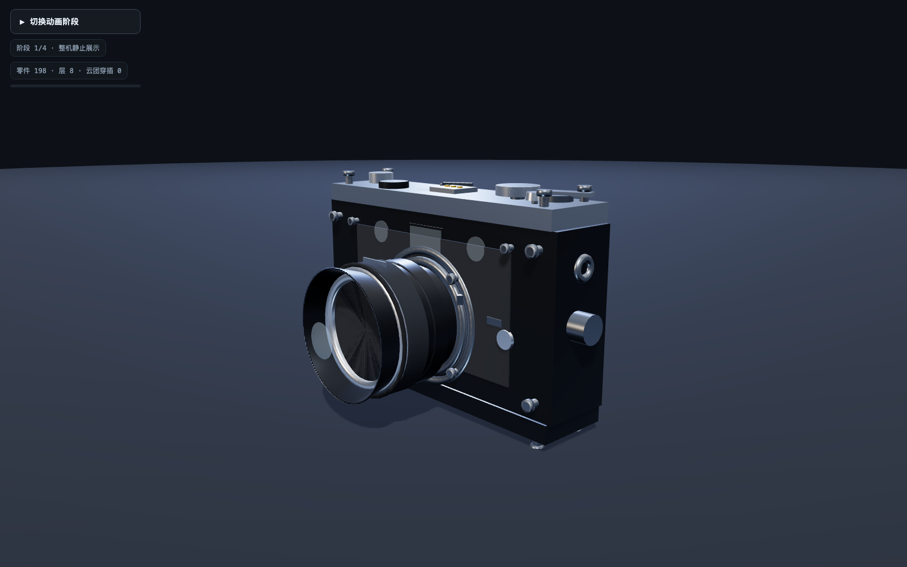

# LongCat-2.5 旁轴相机

纯代码生成的 Three.js 旁轴相机：单文件 HTML，715 行，198 个独立命名的 mesh。按钮依次切换整机展示、拆解、爆炸视图、合体开机。

## 生成归属

| 项目 | 实际使用 |
| --- | --- |
| 生成模型 | LongCat-2.5 |
| Harness | Claude Code 2.1.317 |
| 模型接口 | `https://api.longcat.chat/anthropic` |
| 提示词 | [原始提示词](original-prompt.txt)，与实际 CC 会话中的用户提示词完全一致 |
| 生成文件 | `index.html`、`parts.csv`、`self-check.md`、`shot.sh`、`shots/`，由 LongCat 生成 |
| 核查与发布 | Codex 配置调用、独立核查及整理交付；未代写或修改相机源码 |

相机代码生成没有切换到 Claude 或其他模型。Claude Code 是执行工具调用的 harness，不代表本次使用 Claude 模型。README、独立核查报告及发布包由 Codex 整理。

## 查看作品

下载本仓库，或下载 [完整作品与截图包](LongCat-2.5-rangefinder-camera-github.zip)，解压后在包含 `index.html` 的目录运行：

```sh
python3 -m http.server 8123
```

浏览器打开 `http://127.0.0.1:8123/index.html`。Three.js 从 CDN 加载；几何、材质和 Canvas 纹理在代码内生成，无外部模型、贴图或音频文件。



本仓库为私有仓库，未启用公开网页托管。

## 文件与核查边界

- [index.html](index.html)：原始生成源码，未由 Codex 修改。
- [parts.csv](parts.csv)：198 个零件的名字、所属层与材质。
- [self-check.md](self-check.md)：LongCat 原始自查，保留模型自己的表述；其中部分结论需结合独立核查阅读。
- [run-audit.json](run-audit.json)：Codex 独立核查，区分已验证、流程偏差和未验证项。
- [完整作品与截图包](LongCat-2.5-rangefinder-camera-github.zip)：包含全部 58 张 LongCat 过程截图，以及 `verification/` 下的补充截图和抽样数据。`SHA256SUMS.txt` 提供包内文件校验值。

已实测：198 个 mesh 的名字与 ID 唯一，CSV 与运行时零件逐项一致；按钮循环为 1 → 2 → 3 → 4 → 1；合体终态屏幕与灯光亮起。独立抽样未见 JavaScript 运行异常，但存在非阻断的 favicon 404。

本次不能标记为所有约束通过：

- 后续有使用 Bash/Python 改写 HTML 的操作，且未严格做到每写一块立即截图。
- LongCat 的三轮规定截图为 1500×900，并非要求的 1600×1000。独立核查补充了 1600×1000 截图，不追溯改变原流程结果。
- 螺丝为旋转对称的环状齿纹近似，不是真正连续的螺旋螺纹；原自查中的“完整螺旋”说法不准确。
- 尚未验证整段连续动画完全无穿模。拆解阶段 12 秒抽样中，顶壳和主框架底板部分超出画面；终态抽样未见此取景问题。

源码 SHA-256：

```text
09ddeb28b9ca3def89c1839aed066a1f350b59576fc8102099c224f48e2ae7ee
```

发布文件不包含 API 密钥、模型配置、原始会话日志或本地 harness 可执行文件。
